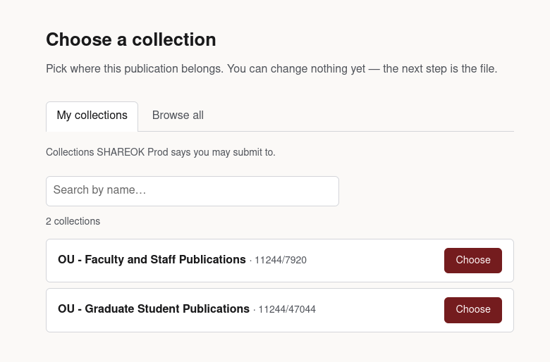
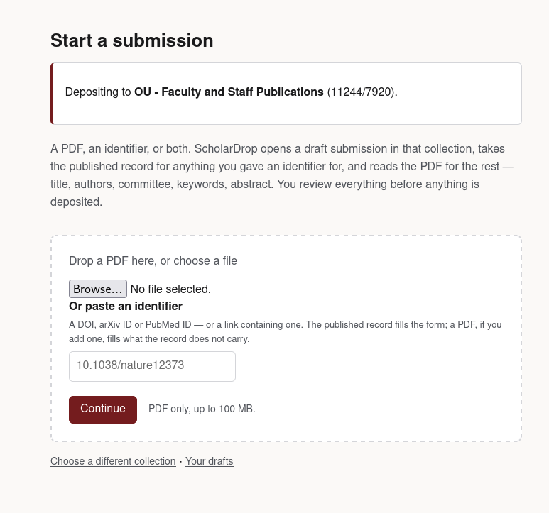

# ScholarDrop

*Drop a PDF. Deposit a publication.*

ScholarDrop is a small web app for depositing publications into a DSpace 7+
repository (built for SHAREOK on DSpace 9.2). Give it a PDF, a published
identifier (DOI, arXiv ID, PubMed ID), or both. It pre-fills the collection's
own submission form, you correct and complete it, and nothing is deposited
until you approve it.


## How it works

1. **Pick a repository and sign in** with your repository account. ScholarDrop
   passes the password to DSpace and does not store it.
2. **Choose a collection.** Only the collections DSpace says you can submit to
   are listed. ScholarDrop has no user database or ACLs of its own.

   

3. **Upload a PDF, paste an identifier, or both.** An identifier is resolved
   to its published record. The PDF supplies the title, authors, committee,
   keywords and abstract, using Claude, a local model for restricted material,
   or heuristics.

   

4. **Review.** The form is generated from the collection's live submission
   definition. Each pre-filled value shows where it came from, required fields
   that are still empty are flagged, and author names can be checked against
   ORCID.

   <p>
     
     
   </p>

5. **Deposit.** Grant the licence and confirm a summary of what will be sent.
   The draft is then patched and submitted through the DSpace REST API. If
   DSpace refuses anything, the draft is kept and the form returns with the
   problem fields marked.

Unfinished drafts, including ones started in the DSpace UI, appear under
**Submissions in progress** (`/drafts`). Everything you have submitted is
under **Your submissions** (`/my-submissions`). Duplicate checks are advisory:
an exact-file match against a harvested checksum index, plus a title match.

## Stack

FastAPI + Jinja2 + HTMX in a single Python process, with YAML config and no
database.

```
Browser ──HTMX──▶ ScholarDrop (FastAPI)
                    ├── DSpace REST client (httpx)
                    ├── Extractor: PyMuPDF + Claude | local model | heuristics
                    ├── Identifiers: repository's import sources, else Crossref/DataCite/arXiv/PubMed
                    └── Dedup: checksum index + title matching
```

## Quick start

Requires Python 3.12+.

```bash
python3.12 -m venv .venv
.venv/bin/python -m pip install -e ".[dev]"
cp .env.example .env                       # optional in dev
.venv/bin/python -m scholardrop            # http://127.0.0.1:8000
```

Tests and lint:

```bash
.venv/bin/python -m pytest -q              # add --e2e for the browser tests (needs Chromium)
.venv/bin/ruff check .
```

## Configuration

- **`config/instances.yaml`** lists the repositories. Each one needs a name,
  a `base_url` (the DSpace `/server` root), a mapping profile, a contact email
  and an extraction tier (`cloud` | `local` | `heuristic`). Optional
  `session_ttl_seconds` and `upload_max_bytes` settings override the global
  defaults for that repository.
- **`config/mappings/*.yaml`** maps extracted fields to DSpace metadata fields.
  Add a profile when a repository's field names differ. No code changes are
  needed.
- **`SCHOLARDROP_*` environment variables** (or `.env`) hold deployment
  settings. See `.env.example` for the full list. `SCHOLARDROP_SECRET_KEY` is
  required in production, and `SCHOLARDROP_ANTHROPIC_API_KEY` enables Claude
  extraction. Without the key, extraction falls back to heuristics.

The app checks both YAML files at startup. If either is malformed, it refuses
to start and reports the file and the problem.

## Useful scripts

| Script | Purpose |
|---|---|
| `scripts/smoke.py` | Read-only checks against a live repository (`--instance <key>`) |
| `scripts/extract_cli.py` | Extract metadata from PDFs without touching DSpace |
| `scripts/resolve_cli.py` | Resolve a DOI, arXiv ID or PubMed ID and show the pre-filled result |
| `scripts/harvest_checksums.py` | Build an instance's checksum index for exact-file duplicate warnings |

## Deployment

The app runs as one uvicorn process on loopback, behind nginx terminating TLS.
The systemd unit and nginx config are in `deploy/`, with install notes at the
top of each file.

- **Use one worker.** Sessions and extraction jobs live in process memory.
- **Set nginx's `client_max_body_size`** at or above the largest upload limit
  you allow. Otherwise nginx rejects large uploads with a bare 413 before the
  app can explain the limit.
- **Check health** with `GET /healthz`. Every log line carries a request ID,
  which is also returned in the `X-Request-ID` header.
