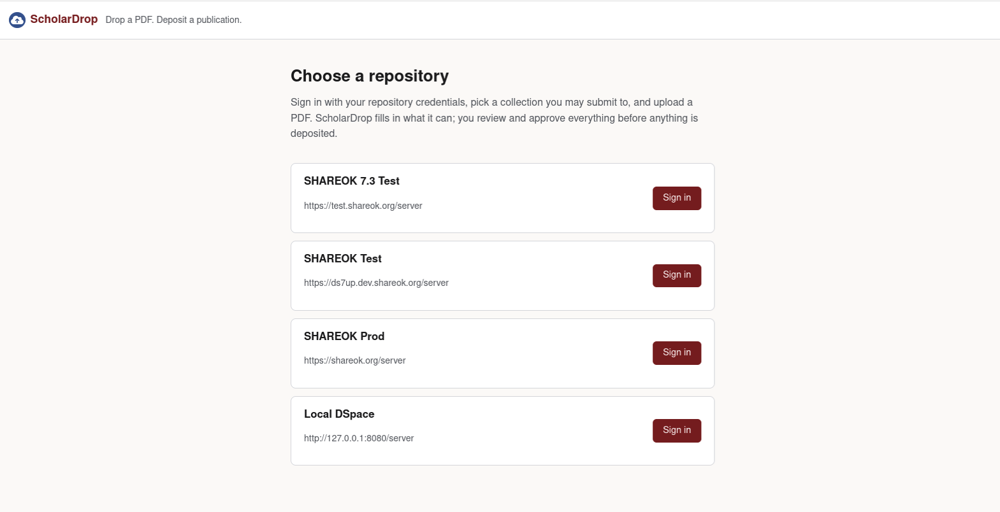
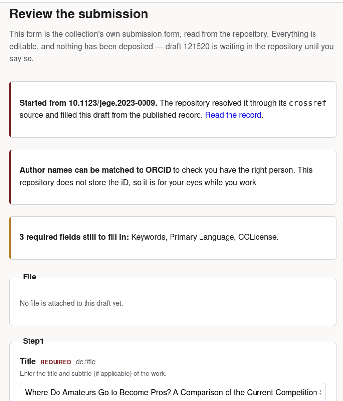
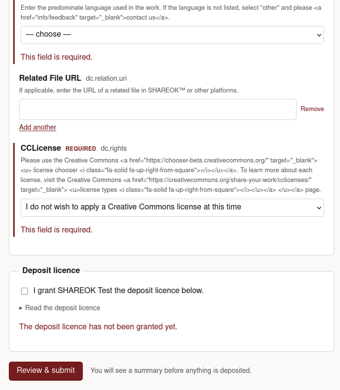

# ScholarDrop

**A Python front end for DSpace submissions**

ScholarDrop is an independent, submission-focused web app for DSpace 7+ repositories. It uses the DSpace REST API to retrieve repository and collection information, prepare and review publication submissions, and send them to DSpace only after the user confirms. It is built for SHAREOK on DSpace 9.2.

Give ScholarDrop a PDF, a published identifier (DOI, arXiv ID, PubMed ID), or both. It pre-fills the selected collection's submission form for you to review and complete. Nothing is deposited until you approve it.

**How it fits with DSpace:** ScholarDrop is a separate Python application that provides an alternative interface for the submission workflow. DSpace remains the repository system of record; ScholarDrop communicates with it through its REST API.

## What it does

- Uses your DSpace account and lists only collections that DSpace says you can submit to.
- Resolves identifiers to publication records and extracts metadata from PDFs.
- Builds the submission form from the selected collection's live submission definition.
- Shows where pre-filled values came from, flags required fields that still need attention, and lets you check author names against ORCID.
- Submits the reviewed draft through the DSpace REST API after you grant the deposit licence and confirm what will be sent.
- Keeps a draft if DSpace refuses a submission, returning you to the form with problem fields marked.

## How it works

1. **Pick a repository and sign in** with your repository account. ScholarDrop passes your password to DSpace and does not store it.
2. **Choose a collection.** Only collections DSpace says you can submit to are listed. ScholarDrop has no user database or access controls of its own.
3. **Upload a PDF, paste an identifier, or both.** An identifier is resolved to its published record. The PDF can supply the title, authors, committee, keywords, and abstract, using Claude, a local model for restricted material, or heuristics.
4. **Review the submission.** The form is generated from the collection's live submission definition. Each pre-filled value shows its source, required fields that remain empty are flagged, and author names can be checked against ORCID.
5. **Deposit.** Grant the licence and confirm a summary of what will be sent. ScholarDrop then patches and submits the draft through the DSpace REST API.








Unfinished drafts, including drafts started in the DSpace UI, appear under **Submissions in progress** (`/drafts`). Submitted items appear under **Your submissions** (`/my-submissions`). Duplicate checks are advisory: ScholarDrop checks for an exact-file match against a harvested checksum index and for a title match.

## Stack

FastAPI, Jinja2, and HTMX run in a single Python process, with YAML configuration and no database.

```text
Browser ──HTMX──▶ ScholarDrop (FastAPI / Python)
                       ├── DSpace REST client (httpx)
                       ├── Metadata extraction: PyMuPDF + Claude | local model | heuristics
                       ├── Identifier lookup: repository import sources, then Crossref/DataCite/arXiv/PubMed
                       └── Duplicate checks: checksum index + title matching
```

## Quick start

Requires Python 3.12+.

```bash
python3.12 -m venv .venv
.venv/bin/python -m pip install -e ".[dev]"
cp .env.example .env  # optional in development
.venv/bin/python -m scholardrop  # http://127.0.0.1:8000
```

Tests and lint:

```bash
.venv/bin/python -m pytest -q  # add --e2e for browser tests (requires Chromium)
.venv/bin/ruff check .
```

## Configuration

- `config/instances.yaml` lists repositories. Each entry needs a name, a `base_url` (the DSpace `/server` root), a mapping profile, a contact email, and an extraction tier (`cloud`, `local`, or `heuristic`). Optional `session_ttl_seconds` and `upload_max_bytes` settings override global defaults for that repository.
- `config/mappings/*.yaml` maps extracted fields to DSpace metadata fields. Add a profile when a repository uses different field names; no code changes are needed.
- `SCHOLARDROP_*` environment variables (or `.env`) hold deployment settings. See `.env.example` for the full list. `SCHOLARDROP_SECRET_KEY` is required in production. `SCHOLARDROP_ANTHROPIC_API_KEY` enables Claude extraction; without it, extraction falls back to heuristics.

The app checks both YAML configuration files at startup. If either is malformed, it refuses to start and reports the file and problem.

## Useful scripts

| Script | Purpose |
| --- | --- |
| `scripts/smoke.py` | Read-only checks against a live repository (`--instance <key>`) |
| `scripts/extract_cli.py` | Extract metadata from PDFs without contacting DSpace |
| `scripts/resolve_cli.py` | Resolve a DOI, arXiv ID, or PubMed ID and show the pre-filled result |
| `scripts/harvest_checksums.py` | Build an instance's checksum index for exact-file duplicate warnings |

## Deployment

The app runs as one Uvicorn process on loopback, behind nginx terminating TLS. The systemd unit and nginx config are in `deploy/`, with installation notes at the top of each file.

- Use one worker. Sessions and extraction jobs live in process memory.
- Set nginx's `client_max_body_size` at or above the largest upload limit you allow. Otherwise nginx may reject uploads with a bare 413 before the app can explain the limit.
- Check health with `GET /healthz`. Every log line carries a request ID, which is also returned in the `X-Request-ID` header.
